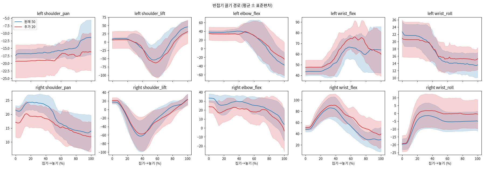
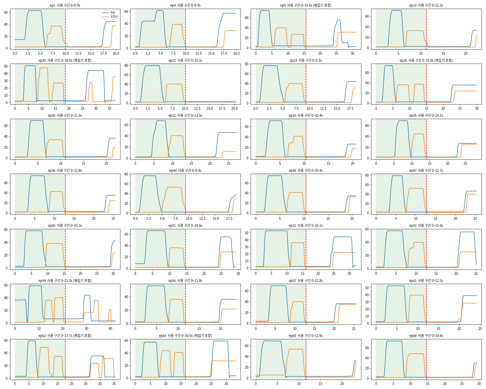

# 2. 데이터 분석과 재구성 (B안)

## 출발점: 두 모델의 장단점이 엇갈림

같은 조건(관절 제한 12°, 30Hz)에서 실물로 돌려 본 결과, 작업자가 이렇게 관찰했습니다.

| 단계 | 더 나은 모델 |
|---|---|
| 집기 | 70개 통 모델 |
| 반접기 (변 정렬) | 50개 모델 |
| 대문접기 이후 | 70개 통 모델 |

70개 모델은 반접기 때 변이 안 맞고 왼쪽이 휘었습니다. 실물 5회 중 4회 성공했지만, 메모마다 "반접기 미흡"이 나왔습니다.

## 원래 50개와 추가 20개 비교

`scripts/data/compare_half_fold_groups.py`로 반접기 구간을 두 묶음으로 나눠 비교했습니다. 요약 수치는 [`results/half_fold_50_vs_20_summary.json`](../results/half_fold_50_vs_20_summary.json)에 있습니다.

| 항목 | 원래 50개 | 추가 20개 |
|---|---|---|
| 반접기 길이 | 27.9 ± 3.9 s | 34.0 ± 3.5 s (약 6초 느림) |
| 왼손 집기 시각 | 6.0 s | 8.0 s |
| 오른손 집는 자세 (elbow / pan) | 24° / 17° | 33° / 21.5° |
| 왼손 놓는 위치 (pan) | -11.4° | -16.3° |

- 추가 20개는 잡는 위치가 다르고 편차가 큽니다(20개 중 10개가 이상치).
- 실물에서 왼손이 놓는 pan은 50개 모델이 -14.2°, 70개 모델이 -17.1°였습니다. **70개 모델은 추가 20개의 놓는 위치를 따라갑니다.**
- 접힌 결과의 면적비(접은 뒤 / 접기 전)는 두 묶음 모두 약 0.54로 같았습니다.



## 반접기 시연 골라내기 (웹 판정)

`scripts/data/serve_half_fold_select.py`와 `towel_half_fold_select.html`(포트 8767)로 70개의 반접기 끝 장면을 하나씩 보고, 변끼리 딱 맞게 접힌 것만 good으로 골랐습니다. 화면에는 참고 지표(왼손 놓기 pan, 면적비)를 함께 띄웠습니다.

- **good 42개**: 원래 50개 중 34개, 추가 20개 중 8개
- **bad 28개**
- 판정 결과: [`results/half_fold_selection.json`](../results/half_fold_selection.json)

## 분할 실행(체인)을 쓰지 않은 이유

처음에는 단계별 모델을 따로 두고 검증기로 넘기는 방식(70 → 50 → 70)도 만들었습니다. 그런데 실물에서 전환이 매끄럽지 않았습니다. 검증기가 전환에 성공한 것은 5회 중 1회였고, 전환 직후 모터 가드 오류가 3회 났습니다. 원인은 세 가지입니다.

1. 단계가 바뀔 때 모델을 새로 로드합니다.
2. 검증기가 팔이 멈출 때까지 기다립니다.
3. ACT 동작 청크가 중간에 끊깁니다.

그래서 **데이터만 구간별로 나누고 모델은 하나로 학습하는 B안**을 택했습니다.

## B안 데이터셋 구성

| 묶음 | 에피소드 | 프레임 | 평균 길이 | 만든 스크립트 |
|---|---|---|---|---|
| good 42개 전체 (반접기 → 대문접기) | 42 | 68,472 | 54.3 s | `build_half42_gate_mix.py` |
| bad 28개의 대문접기 구간 | 28 | 24,417 | 29.1 s | `build_half42_gate_mix.py` |
| bad 28개의 집기 구간 | 28 | 11,122 | 13.2 s | `cut_grasp_only.py` |
| **합계** `local/towel_tape_70_half42_gate28_grasp28` | **98** | **104,011** | | `cut_grasp_only.py --merge` |

- **집기**는 70개 모두에서, **끌기·놓기(반접기)**는 good 42개에서만, **대문접기**는 70개 모두에서 배웁니다.
- 집기 구간은 반접기 시작부터 두 손이 다 닫힌 뒤 15프레임까지입니다. 그리퍼가 완전히 닫힌 뒤(<6°) 2초 안에 다시 열리면(>20°) 첫 집기에 실패한 것으로 보고, 다시 닫은 시점까지 늘렸습니다. 이 규칙이 적용된 에피소드는 ep9, 20, 28, 54, 62, 64입니다.
- 잘린 구간 끝 뒤의 동작은 LeRobot이 패딩(`action_is_pad`)으로 표시하고, ACT는 이를 손실에서 뺍니다. 그래서 "잡은 채 멈추기"를 배우지 않습니다.
- 새 에피소드 번호와 원본 번호의 대응: [`results/dataset_source_mapping.json`](../results/dataset_source_mapping.json)



## 실행 순서

```bash
cd ~/lerobot
uv run python custom_scripts/build_half42_gate_mix.py      # 70개, 92,889프레임
uv run python custom_scripts/cut_grasp_only.py             # 28개, 11,122프레임
uv run python custom_scripts/cut_grasp_only.py --merge     # 98개, 104,011프레임 (개수 자동 검증)
python3 -c "import json;d=json.load(open('outputs/datasets/towel_tape_70_half42_gate28_grasp28/meta/info.json'));print(d['total_episodes'],d['total_frames'])"   # 98 104011
```
